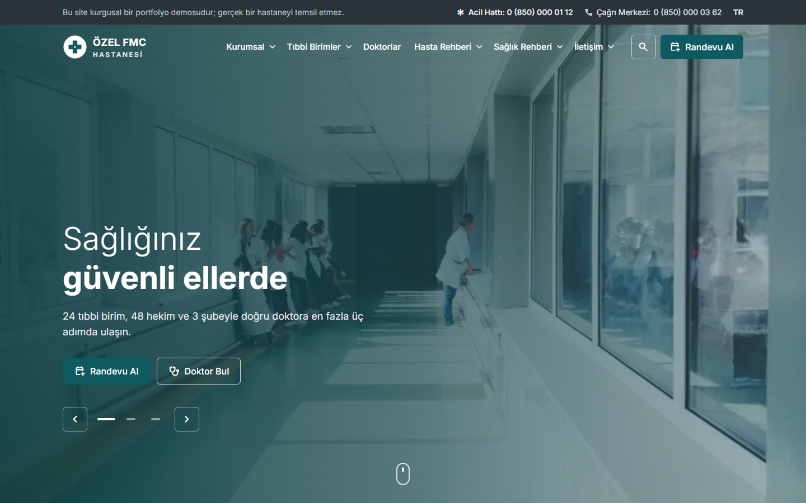
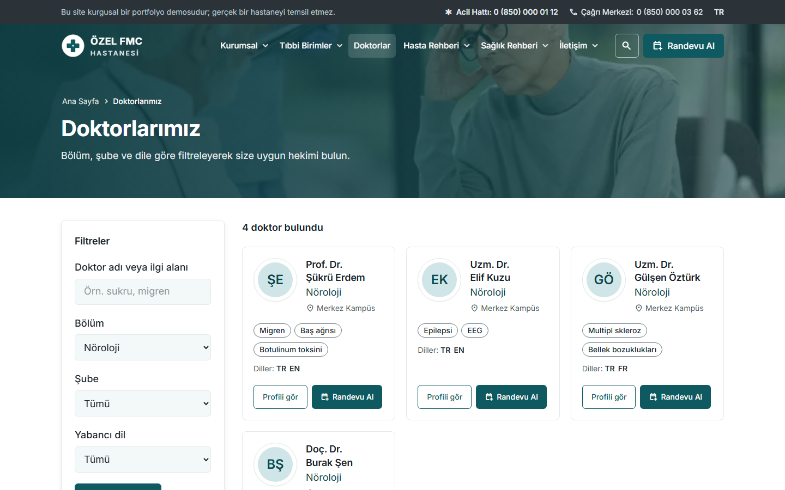
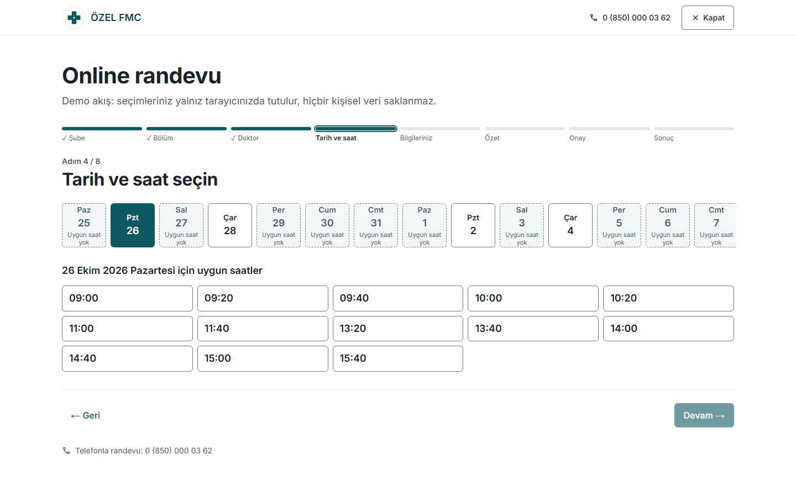
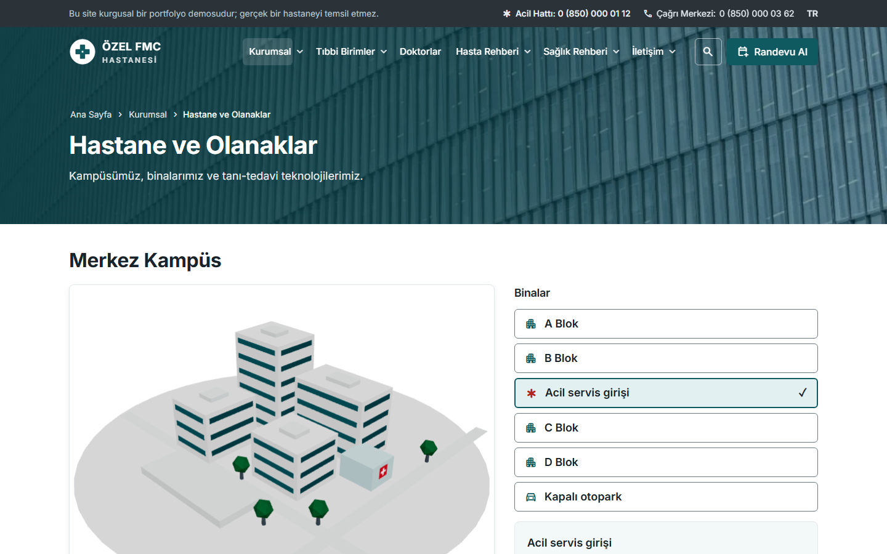
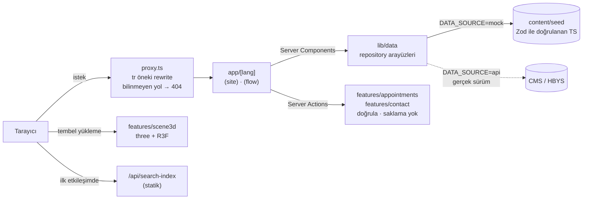

# ÖZEL FMC HASTANESİ — hastane web sitesi demosu

Kurgusal bir hastane için hazırlanmış portfolyo projesi. Bölüm ve doktor keşfi, uçtan uca **simüle** randevu akışı, hasta rehberi, sağlık içerikleri ve etkileşimli 3D kampüs maketi içerir.

> **Tüm kurum, kişi, adres, telefon ve içerikler kurgusaldır.** Formlar yalnız doğrular; hiçbir kişisel veri saklanmaz, loglanmaz veya üçüncü tarafa gönderilmez. Site arama motorlarında listelenmez (`noindex`).



| Doktor bulma                                    | Randevu sihirbazı                                 | 3D kampüs (keşif modu)                             |
| ----------------------------------------------- | ------------------------------------------------- | -------------------------------------------------- |
|  |  |  |

Diğer görüntüler (mobil dahil): [`docs/screenshots/`](docs/screenshots).

## İçindekiler

- [Hızlı başlangıç](#hızlı-başlangıç)
- [Demo senaryoları](#demo-senaryoları)
- [Mimari](#mimari)
- [Teknoloji kararları](#teknoloji-kararları)
- [Klasör yapısı](#klasör-yapısı)
- [Kalite, test ve ölçümler](#kalite-test-ve-ölçümler)
- [Gizlilik ve güvenlik](#gizlilik-ve-güvenlik)
- [Demo ile gerçek hastane arasındaki fark](#demo-ile-gerçek-hastane-arasındaki-fark)
- [Lisanslar ve kaynaklar](#lisanslar-ve-kaynaklar)

## Hızlı başlangıç

Gereksinim: Node 24 (`.nvmrc`) ve pnpm 12 (`corepack enable pnpm` veya `npm i -g pnpm`).

```bash
pnpm install
cp .env.example .env.local
pnpm dev                      # http://localhost:3000
```

Üretim derlemesi: `pnpm build && pnpm start`. Temiz klondan `pnpm install` + `pnpm build`, pnpm önbelleği dolu bir makinede yaklaşık 40 saniye sürdü. Yeni bir makinede paket indirme süresi buna eklenir.

| Komut                                        | Açıklama                                                                                      |
| -------------------------------------------- | --------------------------------------------------------------------------------------------- |
| `pnpm lint` / `pnpm typecheck`               | ESLint (next, jsx-a11y, import sınırları) / route tipleri + `tsc`                             |
| `pnpm test`                                  | Vitest birim testleri                                                                         |
| `pnpm test:e2e`                              | Playwright + axe; önce `pnpm build` ve `pnpm exec playwright install chromium firefox webkit` |
| `pnpm lhci`                                  | Lighthouse CI, bütçeler `lighthouserc.json` (önce `pnpm build`)                               |
| `pnpm check:secrets`                         | Build çıktısında gizli anahtar / sunucu değişkeni taraması                                    |
| `pnpm check:content`                         | İçerik taraması: lorem ipsum, gerçek telefon/e-posta kalıbı, izinsiz dış bağlantı             |
| `pnpm demo:screenshots` / `pnpm demo:videos` | README görüntüleri / demo senaryosu videoları (`pnpm start` çalışırken)                       |
| `pnpm icons:fetch`                           | Material Symbols alt kümesini indirir ve her ikon adını doğrular                              |
| `pnpm analyze`                               | Turbopack paket analizi                                                                       |

Ortam değişkenleri (`.env.example`):

- `NEXT_PUBLIC_SITE_URL`
- `DATA_SOURCE=mock`
- `DEMO_MODE=true` (noindex)
- `APPOINTMENT_CONFLICT_RATE`: randevuda "slot doldu" simülasyonunun olasılığı; testlerde 0.

## Demo senaryoları

Üç senaryo `pnpm demo:videos` ile Playwright'ta kayda alınır (`docs/demo/*.webm`, git dışında) ve E2E testleriyle de doğrulanır.

1. **Doktor bul → randevu:** Ana sayfa aramasına "migren" yazın → Prof. Dr. Şükrü Erdem önerisini seçin → profilde "Randevu Al" → sihirbaz doktor, bölüm ve şube seçili olarak tarih adımından açılır → saat seçin → bilgiler (telefon yalnız kurgusal `0 (500) 000 xx xx` kabul edilir) → özet → onay → randevu kodu ve `.ics` takvim dosyası.
2. **Acil durum ve lokasyon:** Üst çubuktaki "Acil Hattı" her sayfada ilk ekranda bir `tel:` linkidir → Tıbbi Birimler → Acil Servis: telefon ve yol tarifi önde, randevu butonu yok → Lokasyonlar → "Bana en yakın şubeyi bul" (konum tarayıcıda kalır) → şube detayı → harita yalnız onayla yüklenir.
3. **Makaleden randevu:** Sağlık Rehberi → Kadın Sağlığı → makalede yazar, tıbbi gözden geçiren hekim, tarih, kaynaklar ve tıbbi uyarı → "Bu konuda randevu al" → sihirbaz ilgili bölüm seçili açılır.

Ayrıca denenebilecekler:

- `/doktorlar?q=sukru`: aksan duyarsız arama
- `/kurumsal/olanaklar`: 3D'de veya listeden bina seçimi
- `/iletisim`: 6. mesaj rate limit ile reddedilir
- `/boyle-bir-sayfa-yok`: gerçek 404

## Mimari



- **Render:** Next.js 16 App Router, Cache Components (kısmi prerender). 160+ sayfa build sırasında statik üretilir; yalnız `searchParams` okuyan parçalar (`/doktorlar`, `/arama`) `Suspense` içinde akış olarak gelir.
- **Veri:** Sayfalar veriye yalnız `@/lib/data` üzerinden erişir. Gerçek backend geldiğinde yalnız repository uygulaması değişir ([ADR 0001](docs/adr/0001-mvp-icerik-seed.md)).
- **i18n:** `[lang]` kök segmenti + `proxy.ts`; Türkçe URL'ler öneksiz ([ADR 0002](docs/adr/0002-i18n-yerel-sozluk.md)).
- **Gerçek 404:** `proxy.ts`, sitemap'le aynı kaynaktan gelen bilinen yol listesini kontrol eder ve bilinmeyen yolları prerender edilmiş 404 sayfasına yönlendirir. Böylece streaming başlamadan doğru durum kodu döner.
- **Randevu:** 8 adımlı istemci durum makinesi (`useReducer`), adım URL'de (`?adim=`), seçimler `sessionStorage`'da (kişisel alanlar hariç). Slotlar çalışma kurallarından saf fonksiyonla üretilir. Server Action aynı Zod şemasıyla doğrular, idempotency anahtarıyla çift gönderimi engeller ve "slot doldu" senaryosunu simüle eder.

## Teknoloji kararları

| Alan                 | Seçim                                                     | Neden                                                                                                   |
| -------------------- | --------------------------------------------------------- | ------------------------------------------------------------------------------------------------------- |
| Framework            | Next.js 16 App Router, Turbopack                          | Statik üretim + Server Actions + metadata API                                                           |
| Dil                  | TypeScript strict, `noUncheckedIndexedAccess`             | Veri modeli sözleşmeleri                                                                                |
| Stil                 | Tailwind v4 + tek token dosyası (`src/styles/tokens.css`) | Hex değerler yalnız tek dosyada; düz tasarım sistemi ([ADR 0005](docs/adr/0005-duz-tasarim-sistemi.md)) |
| Form                 | Zod (jitless) + React Hook Form                           | Aynı şema istemcide ve sunucuda                                                                         |
| UI primitifleri      | Radix (Dialog, Tabs, Accordion)                           | Hazır ARIA davranışı                                                                                    |
| Tipografi ve ikonlar | Inter + Material Symbols Rounded                          | Google Fonts ile aynı görünüm; font ve ikon alt kümesi kendi sunucumuzdan (KVKK, CSP, performans)       |
| 3D                   | three + React Three Fiber + drei                          | Prosedürel model, ayrı paket, ihtiyaç anında yükleme                                                    |
| Test                 | Vitest, Playwright + axe, Lighthouse CI                   | Birim, E2E, erişilebilirlik, performans bütçesi                                                         |

Plandan bilinçli sapmalar kayıt altında:

- next-intl yerine yerel sözlük: [ADR 0002](docs/adr/0002-i18n-yerel-sozluk.md)
- Nonce tabanlı CSP yerine nonce'suz sıkı CSP; nonce, kısmi prerender ile uyumsuz: [ADR 0003](docs/adr/0003-csp-noncesuz.md)
- "Soft neumorfizm" yerine düz tasarım sistemi; ana sayfa hero'su fotoğraf slider'ı, 3D yalnız Olanaklar sayfasında: [ADR 0005](docs/adr/0005-duz-tasarim-sistemi.md), [docs/perf-3d.md](docs/perf-3d.md)

## Klasör yapısı

```text
src/
  app/[lang]/(site)/…        header + footer'lı sayfalar (ana sayfa, birimler, doktorlar, rehberler…)
  app/[lang]/(flow)/randevu  sade layout'lu randevu sihirbazı
  app/api/search-index       statik otomatik tamamlama indeksi
  components/ui              tasarım sistemi (Button, Form, Card, Dialog, StepIndicator…)
  components/layout          TopBar, mega menülü header, footer, mobil alt çubuk
  features/                  appointments · contact · doctors · search · scene3d · pages · …
  lib/data                   Zod şemaları, repository arayüzleri, mock uygulama, slot üretici
  content/seed               kurgusal veri: 3 şube, 24 birim, 48 doktor, 12 makale, bilgi sayfaları
  i18n                       sözlük ve getDictionary
  proxy.ts                   dil rewrite'ı + gerçek 404
scripts/                     içerik ve sır taraması, ekran görüntüsü/demo videosu üretimi
tests/unit · tests/e2e       Vitest · Playwright
docs/                        plan, ADR'ler, performans ve erişilebilirlik raporları
```

## Kalite, test ve ölçümler

| Kontrol                                | Kapsam                                                                                                                                                                                                                                           | Son sonuç                                                                                                                    |
| -------------------------------------- | ------------------------------------------------------------------------------------------------------------------------------------------------------------------------------------------------------------------------------------------------ | ---------------------------------------------------------------------------------------------------------------------------- |
| Birim (Vitest)                         | Seed şeması ve referans bütünlüğü, slot üretici, randevu ve iletişim şemaları, Server Action'lar, `.ics`, rate limit, site araması, WCAG kontrast oranları (24 çift)                                                                             | 95/95 geçti                                                                                                                  |
| E2E (Playwright)                       | 26 sayfa şablonunda axe + yatay taşma, kırık link taraması, sitemap'teki 126 sayfada H1/başlık/açıklama/canonical/JSON-LD, 3 randevu giriş yolu, ana sayfa slider/sekmeleri, geri/yenile, iletişim formu ve rate limit, 3D yedekleri, CSP ihlali | Chromium + Pixel 7 tüm testler; Firefox, WebKit ve iPhone 13 kritik akışlar. 222 geçti, 20 cihaza özgü test bilinçli atlandı |
| Lighthouse CI (mobil, 3 ölçüm medyanı) | `/`, `/doktorlar`, bölüm detay, `/randevu/yeni`                                                                                                                                                                                                  | Performans 88–93, erişilebilirlik 100, best practices 100, CLS 0                                                             |
| Güvenlik                               | `pnpm audit`, build sır taraması, güvenlik başlıkları testi                                                                                                                                                                                      | Yüksek/kritik zafiyet 0, sızıntı yok                                                                                         |
| İçerik                                 | `pnpm check:content`                                                                                                                                                                                                                             | Temiz                                                                                                                        |

Ayrıntılar:

- [docs/perf-3d.md](docs/perf-3d.md): 3D öncesi/sonrası Lighthouse karşılaştırması ve T11 iyileştirmeleri
- [docs/a11y-audit.md](docs/a11y-audit.md): otomatik denetim kapsamı ve manuel ekran okuyucu kontrol listesi

**Bilinen açıklar:**

- Ana sayfada mobil performans 88 (fotoğraflı hero, LCP ≈ 3,9 s). Planın §13 kabul kriteri (≥ 85) karşılanıyor, T05'teki ≥ 90 hedefi ana sayfada karşılanmıyor.
- Stok fotoğraflar en fazla ~1000 px genişlikte; geniş ekranda hafif yumuşaklık var.
- NVDA/VoiceOver ile manuel ekran okuyucu turu yapılmadı.
- 48 kurgusal hekim adının gerçek hekimlerle tek tek "isim + branş" araması yapılmadı. Her profilde "Demo profil — gerçek bir hekimi temsil etmez" rozeti var.
- İngilizce içerik yok; altyapı hazır.

## Gizlilik ve güvenlik

- Randevu formu T.C. kimlik, şikayet veya sigorta bilgisi istemez. Telefon alanı gerçek numara girilmesini önlemek için yalnız kurgusal kalıbı kabul eder.
- Server Action'lar doğrular ve sonucu döner; hasta bilgisi hiçbir yere yazılmaz ve loglanmaz.
- Çerez kullanılmaz. Harita yalnız onayla yüklenir. Fontlar `next/font` ile kendi sunucumuzdan gelir. "En yakın şube" için kullanılan konum tarayıcıdan çıkmaz.
- İletişim formu: gizli tuzak alan (honeypot), en az doldurma süresi, IP başına 10 dakikada 5 mesaj.
- Başlıklar: CSP, HSTS, `X-Frame-Options: DENY`, COOP, `Referrer-Policy`, `Permissions-Policy`, `X-Robots-Tag: noindex`.

## Demo ile gerçek hastane arasındaki fark

| Alan         | Bu demoda                                 | Gerçek üretim için                                                                     |
| ------------ | ----------------------------------------- | -------------------------------------------------------------------------------------- |
| Veri         | Tipli seed dosyaları                      | Payload CMS + PostgreSQL (`api` repository), editör/tıbbi onay akışı                   |
| Randevu      | Kurallardan üretilen slotlar, kaydedilmez | HBYS/MHRS entegrasyonu, slot kilitleme, SMS OTP kimlik doğrulama, SMS/e-posta (İYS)    |
| Kişisel veri | Toplanmaz                                 | Açık rıza kayıtları, şifreli saklama, saklama süresi, KVKK ve sağlık hukuku incelemesi |
| İletişim     | Doğrulanır, atılır                        | İlgili birim kuyruğu, Redis rate limit, Turnstile                                      |
| Yönetim      | Yok                                       | CMS paneli, rol bazlı yetki, değişmez audit log, personel SSO                          |
| Barındırma   | Herhangi bir Node ortamı                  | Yurt içi barındırma, yedekleme, izleme/alarm, dev/stage/prod ortamları                 |
| Dil          | Türkçe                                    | EN çeviri, gerekirse RTL                                                               |

Tüm yol haritası: [docs/plan.md](docs/plan.md) §11–12.

## Lisanslar ve kaynaklar

- **Yazı tipleri:** Inter (SIL Open Font License), `next/font` ile self-host.
- **İkonlar:** Material Symbols Rounded (Apache 2.0); yalnız kullanılan 62 glif `pnpm icons:fetch` ile indirilip self-host edilir (≈36 KB).
- **Kütüphaneler:** three.js, React Three Fiber ve drei (MIT).
- **Fotoğraflar:** 28 adet CC0 / kamu malı stok fotoğraf (StockSnap, rawpixel; Openverse API ile bulundu), `public/images` altından self-host. Fotoğrafçı ve kaynak listesi: [docs/photo-credits.md](docs/photo-credits.md).
- **Çizimler:** Kampüs SVG'si, 3D maket ve doktor avatarları kodla üretilir.
- **İçerik:** Tüm metinler kurgusaldır. Sağlık rehberi yazıları genel bilgilendirme amaçlıdır ve tıbbi tavsiye yerine geçmez; kaynak olarak WHO ve T.C. Sağlık Bakanlığı ana sayfalarına bağlantı verir.
- **Proje lisansı:** henüz belirlenmedi.

Planlama dokümanı: [docs/plan.md](docs/plan.md) · Çalışma kuralları: [CLAUDE.md](CLAUDE.md)
